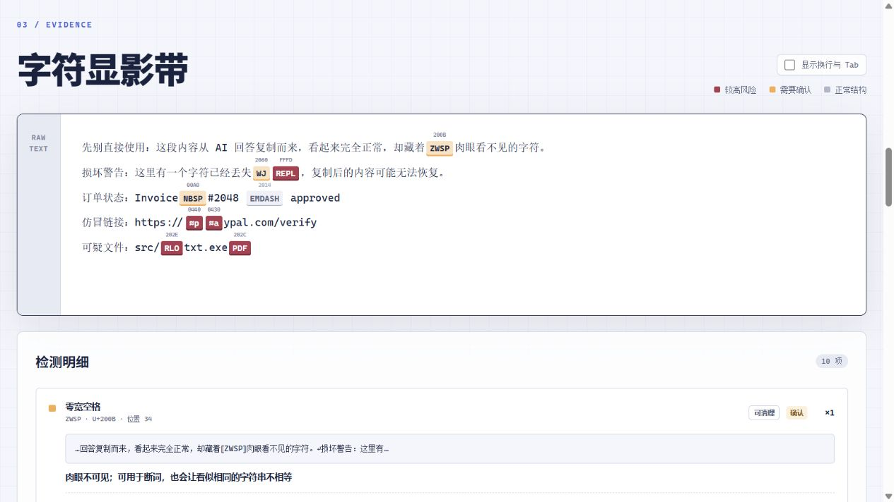

# Paste X-Ray

**让不可见字符留下指纹。**

有些文字看起来完全正常，里面却可能藏着看不见的字符、冒牌字母、反向显示指令或网页标签。它们会让链接失效、代码报错，也可能把假网址伪装成真网址。

Paste X-Ray 会把这些东西直接标出来。你不需要了解字符编码，也不需要安装软件。

> [立即在线使用 Paste X-Ray](https://nisconder.github.io/paste-xray/)



## 看它怎么用


## 三步完成检查

1. 粘贴文字，或者把文件直接拖进输入框。
2. 查看被标出来的位置和处理建议。
3. 清理后复制，或者导出一份网页报告留档分享。

所有检查都在当前浏览器里完成，文字和文件不会上传。

## 安装浏览器插件

插件版支持 Chrome 和 Edge。点击工具栏图标可以打开完整检测页；在网页中选中文字后点右键，也可以直接送进 Paste X-Ray 检查。

目前先提供预发布版。前往 [Releases](https://github.com/nisconder/paste-xray/releases) 下载最新的 `paste-xray-extension-*.zip`：

1. 下载插件 ZIP 并解压。
2. Chrome 打开 `chrome://extensions`；Edge 打开 `edge://extensions`。
3. 打开页面上的“开发者模式”。
4. 点击“加载已解压的扩展程序”，选择解压后的文件夹。
5. 把 Paste X-Ray 固定到浏览器工具栏，即可随时使用。

插件只申请“添加右键菜单”和“临时传递选中文字”两项权限，不读取全部网页，也不主动读取剪贴板。选中的文字被检测页取走后，会立即从插件临时内存中删除。

## 它能帮你发现什么

- 肉眼看不见、却会让搜索或代码出错的隐藏字符
- 长得像英文字母、实际却是另一种字符的“冒牌字母”
- 会把文件名或代码显示顺序偷偷反过来的控制符
- 网页、Word 或 PDF 带来的特殊空格和异常换行
- 从网页粘贴时一起带进来的隐藏标签、样式和链接
- 已经损坏、无法从当前文字中恢复的 `�`

每一项都会告诉你它出现在哪里、可能从哪里来，以及应该保留、清理还是重新确认。

## 主要功能

- 支持直接粘贴、选择文件和拖入文件，单个文件最大 5 MB
- 支持从浏览器工具栏打开，以及右键检查网页中选中的文字
- 检查常见文字、Markdown、代码、JSON、CSV、日志等文件
- 识别网址、账号、文件名和代码中的冒牌字母，同时避免把正常外语整段误报
- 把零宽字符、特殊空格、反向显示指令、异常换行和不可打印字符全部显形
- 分成“较高风险 / 需要确认 / 正常结构”，并展示原文上下文和下一步建议
- 同时查看剪贴板里的纯文字和网页源码
- 所有清理选项默认关闭，确认后再清理和复制
- 导出可独立打开的网页扫描报告，方便留档或发给别人检查

长文本的显影预览最多显示前 10,000 个字符单元（CRLF 作为一个单元），避免一次创建过多页面元素；检测数量、明细和导出报告仍使用全文。超过 20,000 个 UTF-16 单元的输入会在本机 Web Worker 中检测；继续输入会取消上一轮工作，旧结果不会覆盖新文本。`file://` 或不支持 Worker 的浏览器会回退到同步检测。结果传递、页面渲染和导出仍在主线程执行，接近 5 MB 的文件及包含大量异常字符的报告可能需要等待。

## Git 提交检查：Diff X-Ray

无需安装依赖，使用 Node.js 18+ 运行 `bin/diff-xray.cjs`。CLI 与网页、Worker 共用 `core.js` 的字符检测和评级规则，仅检查统一 diff 中的**新增行**，输出目标文件路径、行号、列号、Unicode 码点及原因；它不会修改或清理文件。

```powershell
# 默认检查当前仓库已暂存的改动，适合提交前使用
node path/to/paste-xray/bin/diff-xray.cjs

# 检查尚未暂存的工作区改动
node path/to/paste-xray/bin/diff-xray.cjs --worktree

# JSON 报告；notice 级别也触发失败
node path/to/paste-xray/bin/diff-xray.cjs --staged --json --fail-on notice

# 检查指定提交之间的差异（执行命令时位于待检查仓库）
git diff --no-ext-diff --no-textconv --no-color --src-prefix=a/ --dst-prefix=b/ --unified=0 HEAD~1 HEAD -- | node path/to/paste-xray/bin/diff-xray.cjs --stdin
```

直接读取 Git 的模式会禁用 external diff 和 textconv，固定 `a/`、`b/` 前缀以覆盖用户的 `diff.noprefix` 设置，并读取实际暂存内容，而不是重新打开工作区文件。`--stdin` 接受 UTF-8 统一 diff；生成补丁时请像示例一样固定前缀，避免把真实的 `b/` 目录误认为 Git 前缀。PowerShell 管道需保持 UTF-8 编码，旧版 Windows PowerShell 建议优先使用直接 Git 模式。三个输入模式互斥，`--staged` 为默认值。

退出码为 `0`（未达到失败阈值）、`1`（发现达到阈值的条目）、`2`（Git、格式或输入错误）。默认阈值是 `risk`：零宽空格、特殊空格等 `notice` 会报告但不阻断，`--fail-on notice` 可收紧，`--fail-on never` 可仅收集报告。自然语言、emoji 连接符和双向文字可能有正常用途，需结合上下文复核。

文本输出会显式转义控制符和隐藏格式字符，避免待检查文本反过来改变终端显示。JSON 保留原始上下文，可用于本地 CI 报告；行、列从 1 开始，列按 Unicode 码点计数（emoji 算一个），不是字节或 UTF-16 偏移。

边界：不检查删除行、未跟踪文件、二进制文件或 diff 之外的上下文，不判断程序语言语义。报告会注明跳过的二进制文件数量。LF/CRLF 本身不报告，不能用逐行模式判断全文换行风格；跨行双向控制符的作用范围也不在本版内。合并的 combined diff、不完整 hunk、无效 UTF-8、超过 16 MiB 的补丁、超过 200,000 个 UTF-16 单元的单行，以及超过 10,000 条的异常明细均会失败退出，避免把未完成的扫描显示为干净结果。上下文最多展示前后各 40 个码点，以免长行产生巨量重复报告。BOM 只有位于目标文件第一行第一列时才按编码标记处理；其他位置按文中隐藏字符报告。

可在 Git hook 或 CI 中调用 CLI 并保留退出码。当前版本先提供本地文本和 JSON 报告；规则忽略、历史基线及 SARIF 尚未包含。

## 隐私与安全

- 不需要账号
- 不依赖后端服务
- 不上传或保存检查内容
- 不使用遥测或分析脚本
- 文件读取、文字检查和报告生成都在浏览器本地完成
- 扫描报告会包含被检查的内容，分享前请确认里面没有密码、密钥或个人信息

## 本地运行

这是一个无依赖的纯前端项目。在 Windows 中直接双击 **`打开 Paste X-Ray.cmd`**，也可以直接打开 `index.html`。

如果浏览器限制了本地文件功能，可以在项目目录启动一个临时本地服务器：

```powershell
python -m http.server
```

命令会显示访问地址；在浏览器中打开即可。

## 文件打不开怎么办

大多数由记事本、代码编辑器和办公软件保存的文字文件都能直接读取。如果页面提示无法识别，用记事本打开文件，重新保存后再拖入即可。单个文件不要超过 5 MB。

## 运行测试

```powershell
node --test tests/*.test.cjs
```

自动测试覆盖隐藏字符、冒牌字母、文件读取、误报保护、清理结果和扫描报告，并检查混合文字长段的分析工作量随输入线性增长，以及截断预览不影响全文检测和导出。新增测试验证 Worker 的取消、旧结果隔离和同步回退；Git diff 部分验证真实临时仓库的暂存/工作区区别、多文件多 hunk、引用路径、CRLF、删除行、无效输入和 CI 退出码。

## 构建插件包

```powershell
pwsh -File scripts/build-extension.ps1 -Version 1.0.0-beta.1
```

构建结果和对应的 SHA-256 校验文件会写入 `dist` 目录。

## 反馈

如果你发现漏检、误报或浏览器兼容问题，请[提交 Issue](https://github.com/nisconder/paste-xray/issues)。

## License

[MIT](LICENSE)
